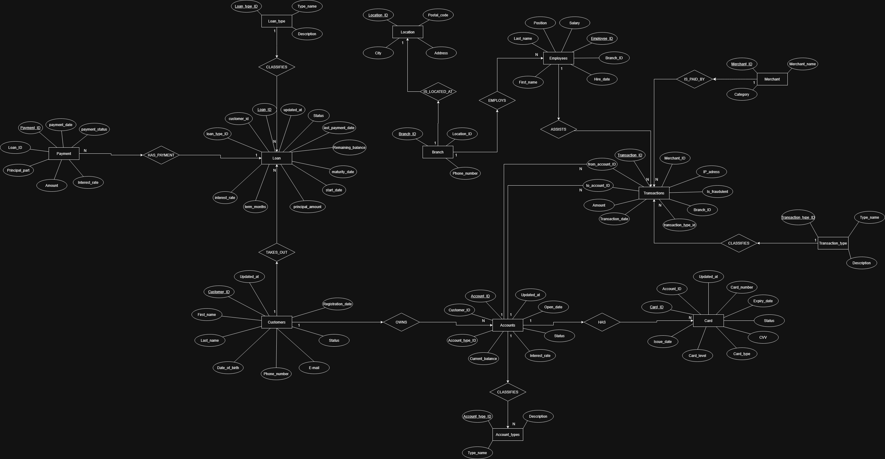

# Banking Data System — Oracle SQL, PL/SQL & APEX

A database system for tracking and analyzing customer data and transactions in a bank: accounts, cards, loans, payments, and fraud flags in one place, with business rules enforced inside the database and a small web app on top.

**Course:** Database Management Systems, SDU University (December 2025)

**Team "Rothschild Family":** Rauza Ramazanova, Ramazan, Aisultan

## My role
I led the project and did the core work:
- Designed the database schema and the ERD (14 tables, keys, and relationships)
- Wrote all PL/SQL packages, triggers, and functions: transactions, loans, risk scoring, fraud auto-freeze, audit logging
- Built the Oracle APEX web app: loan eligibility checker, customer management, and loan simulator
- Prepared the dataset and the presentation

## The problem
In traditional banking, customer and transaction data is scattered across systems, which makes it hard to see the full customer picture, audit changes, and catch suspicious activity. We designed one normalized database that keeps everything consistent automatically.

## What's inside

**Database design**
- 14 related tables: customers, accounts, cards, loans, payments, transactions, branches, employees, merchants, locations, lookup tables, and a system log
- Full ERD (`erd.png`, editable in draw.io: `erd.drawio.xml`)
- Realistic synthetic dataset: 1,000 customers and 10,000 transactions (CSV files)

**Business logic in PL/SQL**
- `pkg_transaction_core`: deposit, withdraw, and transfer with validation
- `pkg_loan_core`: monthly payment calculation (annuity formula), loan payments, automatic overdue detection
- `pkg_customer_tools`: customer profile (total balance and debt) and risk score
- `pkg_branch_reporting`: daily totals per branch
- `pkg_log_system`: central audit log for every transaction

**Triggers that keep data safe**
- Balances update automatically on every transaction
- Balance can never go negative
- Freezing a customer automatically freezes their accounts and blocks their cards
- Cards expire automatically
- Customers with 3+ fraudulent transactions in 24 hours are frozen automatically

**Oracle APEX web app**
- **Loan eligibility checker:** scores a customer by balance, current debt, and late loans, then creates the loan only if they qualify
- **Customer management:** search plus adding new customers with validation (unique email and phone, no future birth dates)
- **Loan simulator:** monthly payment, total interest, and total payable

## Files
| File | Content |
|---|---|
| `banking_system.sql` | Tables, packages, triggers, functions, app logic |
| `apex_application_export.sql` | Exported Oracle APEX application |
| `*.csv` | Data for all tables |
| `presentation.pdf` | Project presentation |
| `erd.png` | Entity-relationship diagram |

## Tech
Oracle Database, SQL, PL/SQL, Oracle APEX, draw.io
